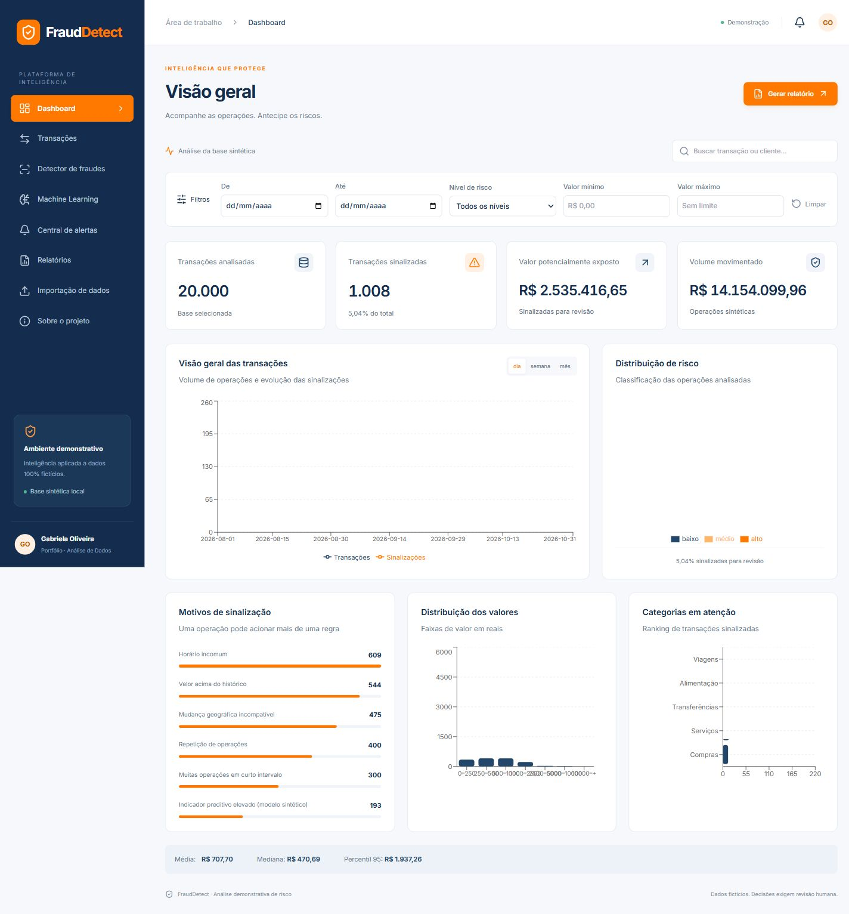

# FraudDetect

**Plataforma inteligente de análise de risco e detecção de fraudes**

Python · FastAPI · React · TypeScript · SQLite · Scikit-learn

## [Abrir o FraudDetect — site funcionando](https://gabmali.github.io/frauddetect/)

Acesso público e gratuito, sem login. Explore 20.000 transações fictícias, filtros, gráficos, detalhes, modelos e relatórios CSV, Excel e PDF.

[Como o site é publicado](docs/PUBLICACAO.md) · [Código no GitHub](https://github.com/gabmali/frauddetect) · [Validação e evidências](docs/PORTFOLIO.md)



Validação final, evidências e roteiro de apresentação: [docs/PORTFOLIO.md](docs/PORTFOLIO.md).

**Validação de portfólio concluída em 03/11/2026:** 54 testes automatizados aprovados (39 de backend e 15 de frontend), build de produção validado e roteiro funcional no Microsoft Edge aprovado manualmente pela usuária. Escopo e limitações estão registrados no relatório final.

Plataforma inteligente de detecção de fraudes — projeto de análise de risco com **dados 100% fictícios**. Projeto de portfólio de Gabriela Oliveira.

O problema de negócio é priorizar operações que merecem revisão humana. O sistema reúne exploração de transações, regras explicáveis, avaliação de Machine Learning e acompanhamento de alertas. Sinalização de risco não comprova fraude.

## Demonstração online e projeto completo

A versão no **GitHub Pages** executa as consultas no navegador. O pipeline Python gera os dados sintéticos, treina os modelos e exporta os resultados durante a publicação. Os gráficos, filtros, ordenação, paginação, detalhes e downloads funcionam sem um servidor Python online. Não é necessário instalar nada para visitar o site.

A demonstração pública é de consulta: importação de bases, edição de regras e gravação de análises ficam disponíveis na instalação local com FastAPI e SQLite. Os modelos são demonstrativos e os scores não são probabilidades calibradas.

## Funcionalidades

- Dashboard calculado a partir do SQLite, com filtros por período, risco, valor e busca; agrupamento diário, semanal e mensal, linha temporal, rosca, barras, histograma e categorias.
- Tabela com paginação no servidor, ordenação, detalhes e exportação CSV.
- Cinco regras configuráveis; score híbrido e justificativas por operação.
- Random Forest e regressão logística: precisão, recall, F1, PR-AUC, matriz de confusão e importância de variáveis.
- Alertas com quatro status, observações e trilha de alterações persistida.
- Relatórios CSV, Excel e PDF, com comparação de períodos no painel.
- Importação CSV/XLSX em duas etapas: validação/prévia e confirmação. IDs duplicados e linhas inválidas são ignorados e reportados.
- Interface em português, responsiva, com Inter local, Lucide, estados de carregamento, erros e navegação por teclado.

## Tecnologias e arquitetura

React 18, TypeScript, Vite, Tailwind CSS, Recharts e Lucide → FastAPI → SQLAlchemy/SQLite. Pandas, NumPy e Faker geram e analisam os dados. Scikit-learn implementa os modelos. Pytest e Vitest verificam as funcionalidades. Openpyxl e ReportLab geram arquivos localmente.

```text
backend/
  app/engine.py       # geração, histórico causal, regras, treino e inferência
  app/database.py     # entidades SQLAlchemy e persistência em lote
  app/importing.py    # validação de arquivos
  app/main.py         # endpoints e agregações
  tests/             # testes unitários e integração
frontend/
  src/components/    # filtros, cards, tabela e diálogo
  src/pages/         # oito páginas da aplicação
  src/hooks/         # consultas, carregamento e erros
  src/services/      # cliente HTTP e formatação
  src/types/         # contratos TypeScript
  src/styles/        # identidade visual e breakpoints
data/synthetic/      # arquivos gerados; ignorados no Git
scripts/seed.py
docs/
```

O backend usa módulos pequenos em vez de pastas vazias por camada. Clientes, transações, alertas, histórico, resultados dos modelos e configurações possuem tabelas próprias. Índices cobrem cliente, data, risco e status. Filtros e paginação são executados no SQL.

## Instalação

Requisitos: **Python 3.12+ e Node.js 24 LTS**, npm. Execute todos os comandos de backend na raiz do projeto. Não use Python 3.7 ou Node 20.15.

```powershell
python -m venv .venv
.\.venv\Scripts\python.exe -m pip install -r backend/requirements.txt
cd frontend
npm ci
cd ..
```

Linux/macOS: use `python3` e `.venv/bin/python` nos comandos correspondentes.

### Executar

Em um terminal na raiz:

```powershell
.\.venv\Scripts\python.exe -m uvicorn backend.app.main:app --host 127.0.0.1 --port 8000
```

A primeira inicialização gera 20.000 transações, 500 clientes e treina os modelos. Aguarde a mensagem `Application startup complete`. Reinicializações reutilizam o banco.

Em outro terminal:

```powershell
cd frontend
npm run dev
```

Abra http://127.0.0.1:5173. Documentação da API: http://127.0.0.1:8000/docs. O frontend encaminha `/api` ao backend via proxy Vite.

Alternativamente, no Windows: `powershell -File scripts/start.ps1` abre os dois processos sem janelas adicionais, mostra a URL e mantém o terminal ativo; Ctrl+C encerra os processos.

### Gerar dados e CSV

```powershell
.\.venv\Scripts\python.exe -m scripts.seed --count 20000
```

Semente padrão: 42. Período: agosto a outubro de 2026. O script gera `data/synthetic/transactions.csv`. A carga é idempotente: não substitui um banco existente. Para uma base independente, defina `DATABASE_URL` e `MODEL_PATH` para novos arquivos locais antes de executar; preserve o par banco/modelo.

### Configuração

`.env.example` documenta as variáveis; configure-as no shell (o arquivo `.env` não é carregado automaticamente):

```powershell
$env:DATABASE_URL='sqlite:///./data/frauddetect.db'
$env:MODEL_PATH='data/model.joblib'
$env:FRONTEND_ORIGIN='http://localhost:5173'
```

Nunca carregue um arquivo `joblib` de terceiros. O programa só gera e lê seu próprio artefato local. Banco, modelo, ambiente virtual e dados gerados estão no `.gitignore`.

### Testes e build

```powershell
.\.venv\Scripts\python.exe -m pytest backend/tests -q
cd frontend
npm test
npm run build
npm audit
```

O build gera `frontend/dist`. Ele precisa de um servidor que encaminhe `/api` ao FastAPI; `vite preview` pode ser usado em avaliação local. Não hospede apenas os arquivos estáticos esperando que o SQLite ou Python executem no navegador.

## Metodologia

Valores seguem distribuições lognormais com perfis de cliente e cenários rotulados de comportamento suspeito. As variáveis são razão valor/média anterior, frequência, horário incomum, mudança de cidade em intervalo curto e repetição de valor. Na primeira operação, a razão vale 1 por falta de histórico.

Treino nos primeiros 80% dos eventos e teste nos últimos 20%, sem embaralhamento. O scaler da regressão logística ajusta somente no treino. Os históricos usam apenas eventos anteriores; eventos do teste podem compor o histórico de eventos posteriores, simulando observação online. Clientes conhecidos podem aparecer em ambos os períodos.

O score das regras soma 35/25/10/25/20 pontos, limitado a 100. Após o corte de treino, o Random Forest acrescenta até 20 pontos; eventos do período de treino usam somente regras, evitando pontuação aparente de teste dentro do treino. O indicador preditivo **não é probabilidade calibrada**. Baixo: <30; médio: 30–59; alto: ≥60. Mudanças de regras reavaliam o histórico, preservando casos e observações anteriores. As métricas exibidas são de cada modelo isolado, não do detector híbrido completo.

## Importação e segurança

Use `docs/modelo.csv` ou baixe o modelo na tela. Colunas obrigatórias: `id, customer_id, timestamp, amount, city, state, category, kind, channel`. Valor positivo com ponto decimal e data ISO sem fuso. Rótulos enviados não são usados em treino.

Aceita até 5 MB e 5.000 linhas, somente CSV UTF-8 e XLSX. Limita XLSX descompactado a 30 MB; rejeita fórmulas e células iniciadas por caracteres de fórmula. Não executa scripts/macros. As prévias expiram em 15 minutos e são locais ao processo (máximo 10 abertas); execute um worker. Exportações neutralizam fórmulas em textos. Paginação limitada a 100 itens. Consultas usam parâmetros SQLAlchemy. CORS restrito ao frontend configurado.

Esta versão não tem autenticação, múltiplos usuários, rate limit distribuído ou migrações de esquema. Execute apenas no loopback. O histórico é uma trilha de demonstração local, sem assinatura ou garantia de imutabilidade. Uploads retroativos reconstroem os indicadores; os modelos e suas métricas mantêm a versão original e não são retreinados com uploads sem rótulo.

## Exemplos de telas e demonstração

Dashboard: quatro indicadores, evolução temporal, risco, motivos e categorias. Transações: busca e detalhes. Machine Learning: comparação e matriz de confusão. Alertas: revisão e histórico.

[Capturas das telas](docs/screenshots/) · [Repositório GitHub](https://github.com/gabmali/frauddetect) · [Perfil de Gabriela Oliveira](https://github.com/gabmali)

A URL pública definitiva será destacada no início deste README após a conclusão e verificação do deploy. O endereço `127.0.0.1` é exclusivo da execução local.

## Limitações e próximas melhorias

Dados simulados produzem métricas otimistas e não representam prevalência ou comportamento reais. Horário e mudança de cidade são aproximações simples. Não há geolocalização real, prova de fraude ou integração bancária. O volume atual permite agregações em memória; grandes bases exigiriam agregações SQL e processamento assíncrono. Próximos passos: autenticação, migrações Alembic, testes end-to-end em CI, calibração, validação por cliente, versionamento de modelos, avaliação do detector híbrido e drift.

Nenhum serviço pago, conta em nuvem ou API externa é necessário para executar. Após instalar as dependências, fontes, geração, treino, análise e exportação funcionam localmente.

Resultados da execução e avisos conhecidos: [docs/VALIDACAO.md](docs/VALIDACAO.md). `backend/requirements-lock.txt` registra as versões Python usadas nesta validação; pode ser utilizado no lugar de `requirements.txt` para reproduzir esse ambiente.

Histórico de QA: [docs/QA.md](docs/QA.md). A validação final soma 47 testes automatizados, além dos fluxos manuais registrados em [docs/PORTFOLIO.md](docs/PORTFOLIO.md).
